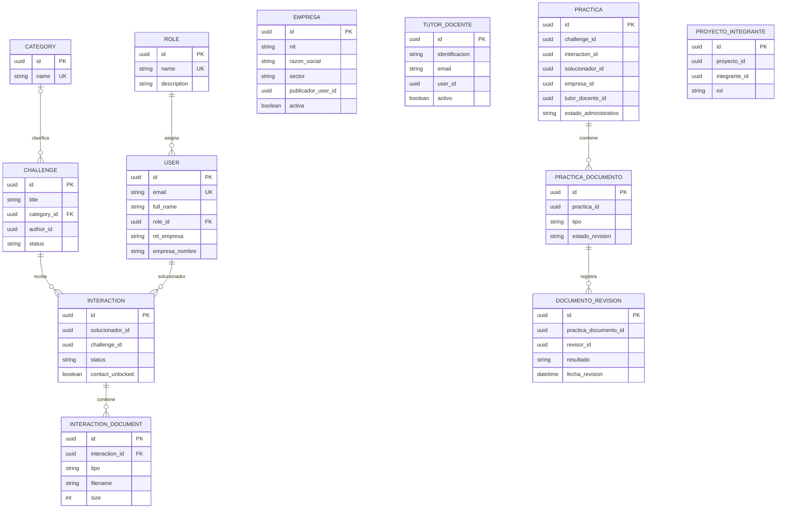

# Diseño del modelo de datos — Módulo de gestión de prácticas empresariales
> **Estado:** propuesta de diseño documental. Este archivo no implementa ni autoriza cambios en código, modelos ORM, esquemas SQL, migraciones, endpoints, frontend, autenticación, roles o permisos.

>

> **Alcance de la evidencia:** las entidades existentes `User`, `Interaction` e `InteractionDocument` fueron **cotejadas contra los modelos fuente reales** durante la revisión final de esta fase; sus campos, tipos, nulabilidad, claves e índices figuran como verificados en el diccionario. Las entidades nuevas siguen siendo propuestas y las decisiones institucionales sin aprobación se mantienen pendientes. Las entidades de contexto (`ROLE`, `CATEGORY`, `CHALLENGE`) aparecen en el diagrama a modo ilustrativo y no forman parte del diccionario.

## Convenciones
- **Existente — verificado:** entidad presente en el código y cotejada contra su modelo fuente; no debe modificarse como parte de este documento.
- **Propuesta de diseño:** entidad o atributo sugerido, todavía no implementado.
- **Pendiente de confirmar:** decisión que requiere evidencia del repositorio o aprobación institucional.
- Las referencias entre servicios se representan mediante UUID y validaciones de aplicación. No se proponen claves foráneas que crucen esquemas o límites de servicio.

## A. Objetivo y alcance
Este documento define una propuesta de modelo de datos para apoyar la gestión institucional de prácticas empresariales en VíaLibre. Separa el flujo existente de publicación y postulación del expediente formal de una práctica.

El diseño considera:

- La posible formalización de una práctica relacionada con una interacción aprobada.
- Los documentos del expediente formal y su historial de revisión.
- La representación institucional de empresas, distinta de la cuenta de quien publica.
- La información de tutores docentes.
- La asociación de integrantes a proyectos de creación de empresa, únicamente si se aprueba esa funcionalidad.

El seguimiento, la evaluación, la homologación y la creación de empresas se mencionan como procesos que requieren definición adicional. Este documento no incorpora entidades para esos procesos fuera de las nueve incluidas en el diccionario.

**Fuera del alcance:** implementación de modelos, tablas, migraciones, endpoints, cambios en el frontend, autenticación, roles, permisos o configuración de despliegue.

## B. Arquitectura y propiedad de los datos
La arquitectura descrita en el diagnóstico previo es la siguiente. Los nombres y la propiedad deben comprobarse contra la configuración vigente del repositorio antes de implementar cambios.

| Servicio descrito | Prefijo API descrito | Esquema descrito | Dominio principal descrito |
|---|---|---|---|
| `auth-service` | `/api/v1/auth` | `vialibre_auth` | Autenticación, usuarios y roles |
| `core-service` | `/api/v1/core` | `vialibre_core` | Categorías y publicaciones (`Challenge`) |
| `match-service` | `/api/v1/match` | `vialibre_match` | Interacciones (`Interaction`) y documentos de interacción |

### Límites entre servicios
- Una referencia a una entidad de otro servicio se guarda como UUID y se valida en la capa de aplicación.
- No se deben crear claves foráneas SQL entre esquemas o servicios distintos.
- La propiedad definitiva de las entidades propuestas está pendiente de la decisión D11.
- La distribución sugerida en este documento no es una decisión arquitectónica aprobada.

## C. Modelo conceptual
### Entidades existentes verificadas en el código
1. `User`: cuenta y perfil de usuario (`services/auth-service/app/models/user.py:11-57`), esquema `vialibre_auth`.
2. `Interaction`: postulación o interacción entre un solucionador y una publicación (`services/match-service/app/models/interaction.py:17-40`), esquema `vialibre_match`.
3. `InteractionDocument`: documento asociado a una interacción (`services/match-service/app/models/document.py:11-33`), esquema `vialibre_match`.

### Entidades propuestas
4. `Empresa`: registro institucional de empresa, distinto de la cuenta publicadora.
5. `TutorDocente`: información del tutor docente; su identidad y posible vínculo con `User` están pendientes.
6. `Practica`: expediente formal de práctica, separado de `Interaction`.
7. `PracticaDocumento`: documento del expediente formal de práctica.
8. `DocumentoRevision`: historial de revisiones de un documento de práctica.
9. `ProyectoIntegrante`: asociación condicional de integrantes a un proyecto de creación de empresa. La entidad principal del proyecto queda fuera del alcance de este diseño.

**Regla central:** aprobar una `Interaction` no crea automáticamente una `Practica`. El momento de formalización y la cardinalidad entre ambas entidades requieren aprobación institucional (D6).

### Diagrama ER
El diagrama distingue entidades de contexto, entidades existentes verificadas y propuestas. Solo dibuja relaciones cuya interpretación se puede expresar sin resolver las decisiones institucionales pendientes. Las referencias entre servicios que aparezcan en el diagrama son relaciones lógicas, no claves foráneas SQL cruzadas.

**Nota sobre el diagrama:** `ROLE`, `CATEGORY` y `CHALLENGE` son entidades de contexto; no forman parte de las nueve entradas del diccionario de este módulo. El diagrama no declara relaciones SQL entre esquemas. Las cardinalidades y los campos de las entidades actuales (`USER`, `INTERACTION`, `INTERACTION_DOCUMENT`) ya fueron cotejadas con los modelos fuente; `CATEGORY`—`CHALLENGE` se representa como relación opcional porque `Challenge.category_id` admite nulos.

## D. Diccionario de datos por entidad
Los tipos, nulabilidad, valores por defecto y restricciones de las entidades nuevas son recomendaciones iniciales, no un contrato de implementación. Cuando la información no está definida, se indica expresamente como pendiente. Para las entidades existentes (`User`, `Interaction` e `InteractionDocument`), la estructura que aparece aquí fue verificada contra los modelos fuente del repositorio.

### D.1 `User` — existente; verificado en el código
**Propósito:** cuenta de autenticación y perfil.

**Servicio/esquema verificado:** `auth-service` / `vialibre_auth` — `services/auth-service/app/models/user.py:11-57`.

| Campo | Tipo verificado | Nulabilidad / valor por defecto | Restricción / observación |
|---|---|---|---|
| `id` | UUID | No nulo | Clave primaria; `default=uuid.uuid4` |
| `email` | String(255) | No nulo | `unique=True, index=True` |
| `password_hash` | String(255) | No nulo | Credencial; no exponer ni registrar |
| `full_name` | String(255) | No nulo | Perfil |
| `role_id` | UUID | No nulo | FK intraesquema a `vialibre_auth.roles.id`; sin índice propio |
| `is_active` | Boolean | No nulo; `default=True` | Desactivación lógica |
| `avatar_url` | String(512) | Nulo | Perfil |
| `phone` | String(20) | Nulo | Perfil |
| `bio` | String(500) | Nulo | Perfil |
| `nit_empresa` | String(20) | Nulo | Campo existente que se debe conservar |
| `empresa_nombre` | String(255) | Nulo | Campo existente que se debe conservar |
| `programa_academico` | String(255) | Nulo | Perfil académico |
| `afiliacion_academica` | String(255) | Nulo | Semilleros, capítulos |
| `skills`, `soft_skills` | JSONB | Nulos | Habilidades; estructura JSON |
| `linkedin_url`, `github_url`, `portfolio_url` | String(512) | Nulos | URLs del perfil |
| `ubicacion` | String(120) | Nulo | Perfil |
| `semestre` | String(30) | Nulo | Estudiantes (texto libre) |
| `anio_egreso` | Integer | Nulo | Egresados |
| `disponible` | Boolean | No nulo; `default=True`, `server_default true` | Disponibilidad |
| `cv_filename` | String(255) | Nulo | Hoja de vida PDF |
| `cv_size` | Integer | Nulo | Tamaño del PDF |
| `cv_updated_at` | DateTime | Nulo | Fecha de actualización del CV |
| `cv_data` | LargeBinary | Nulo; `deferred` | Bytes del PDF, cargados solo al descargar |
| `created_at` | DateTime | No nulo; `default=utcnow` | Auditoría |
| `updated_at` | DateTime | No nulo; `default/onupdate=utcnow` | Auditoría |

- **PK:** `id` (UUID).
- **FK intraesquema:** `role_id` → `vialibre_auth.roles.id` (no nulo).
- **Referencias UUID a otros servicios:** ninguna; no se describen referencias salientes.
- **Índices/únicos:** `email` único y con índice (`ix_users_email`); `role_id` sin índice propio.
- **Integridad:** conservar `nit_empresa` y `empresa_nombre`; no duplicar ni migrar esos datos sin decisión aprobada (D4).
- **Eliminación:** no hay borrado físico descrito; la baja se refleja con `is_active`.

### D.2 `Interaction` — existente; verificado en el código
**Propósito:** postulación o solicitud entre un solucionador y una publicación.

**Servicio/esquema verificado:** `match-service` / `vialibre_match` — `services/match-service/app/models/interaction.py:17-40`.

| Campo | Tipo verificado | Nulabilidad / valor por defecto | Restricción / observación |
|---|---|---|---|
| `id` | UUID | No nulo | Clave primaria; `default=uuid.uuid4` |
| `solucionador_id` | UUID | No nulo | Referencia lógica a `User`; `index=True` |
| `challenge_id` | UUID | No nulo | Referencia lógica a `Challenge`; `index=True` |
| `status` | Enum `InteractionStatus` | No nulo; `default=pendiente` | Valores: `pendiente`, `aprobado`, `rechazado` |
| `message` | Text | Nulo | Mensaje de postulación |
| `contact_unlocked` | Boolean | No nulo; `default=False` | Desbloqueo de contacto |
| `contact_unlocked_at` | DateTime | Nulo | Momento de desbloqueo de contacto |
| `created_at` | DateTime | No nulo; `default=utcnow` | Auditoría |
| `updated_at` | DateTime | No nulo; `default/onupdate=utcnow` | Auditoría |

- **PK:** `id`.
- **FK intraesquema:** ninguna hacia `User` ni `Challenge`; estas referencias cruzan servicios.
- **Referencias UUID:** `solucionador_id` a `User` y `challenge_id` a `Challenge` (validadas en la capa de aplicación).
- **Índices/únicos:** índice en `solucionador_id`, índice en `challenge_id` y `UNIQUE (solucionador_id, challenge_id)` con nombre `uq_solucionador_challenge`.
- **Integridad:** validar en la capa de aplicación la existencia de usuario y publicación. Los cambios de estado deben respetar las transiciones que existan en el código.
- **Eliminación:** no hay borrado en cascada descrito; la política de conservación debe confirmarse con las reglas operativas.

### D.3 `InteractionDocument` — existente; verificado en el código
**Propósito:** documento asociado al expediente de una interacción.

**Servicio/esquema verificado:** `match-service` / `vialibre_match` — `services/match-service/app/models/document.py:11-33`.

| Campo | Tipo verificado | Nulabilidad / valor por defecto | Restricción / observación |
|---|---|---|---|
| `id` | UUID | No nulo | Clave primaria; `default=uuid.uuid4` |
| `interaction_id` | UUID | No nulo | FK local a `vialibre_match.interactions.id`, `ON DELETE CASCADE`; `index=True` |
| `tipo` | String(40) | No nulo | Parte de la restricción única compuesta |
| `filename` | String(255) | No nulo | Nombre del archivo |
| `content_type` | String(100) | No nulo | Tipo de contenido MIME |
| `size` | Integer | No nulo | Tamaño del archivo |
| `data` | LargeBinary | No nulo; `deferred` | Binario cargado solo al descargar |
| `uploaded_at` | DateTime | No nulo; `default=utcnow` | Fecha de carga |

- **PK:** `id`.
- **FK intraesquema:** `interaction_id` → `vialibre_match.interactions.id` (no nula) con `ON DELETE CASCADE`, verificado en modelo y migración.
- **Restricción única:** `UNIQUE (interaction_id, tipo)`, nombre `uq_interaction_document_tipo` (verificado).
- **Comportamiento derivado:** como máximo un documento de cada `tipo` por interacción. No cambiarla como parte de este diseño.
- **Referencias UUID a otros servicios:** ninguna; no se describen referencias salientes.
- **Eliminación:** al borrar la interacción, sus documentos se eliminan en cascada (FK local verificada).
- **Cambio futuro:** permitir múltiples documentos del mismo tipo o ampliar el catálogo requiere decisión y migración específica (D7); no se propone modificarlo ahora.

### D.4 `Empresa` — propuesta de diseño; D4 y D11 pendientes
**Propósito:** representar una empresa en el ámbito institucional, separada de la cuenta de una persona que publica oportunidades.

**Servicio/esquema propuesto:** por decidir. El diagnóstico previo sugirió `auth-service` / `vialibre_auth`, pero no se considera una decisión aprobada.

| Campo | Tipo recomendado | Nulabilidad / valor por defecto | Restricción / observación |
|---|---|---|---|
| `id` | UUID | No nulo | PK propuesta |
| `nit` | String(20) | Pendiente | Posible único; confirmar reglas para empresas sin NIT |
| `razon_social` | String(255) | No nulo propuesto | Nombre legal |
| `sector` | String(100) | Nulo propuesto | Clasificación sectorial |
| `representante_legal` | String(255) | Nulo propuesto | Dato del representante |
| `contacto_email` | String(255) | Nulo propuesto | Contacto institucional |
| `contacto_telefono` | String(50) | Nulo propuesto | Contacto institucional |
| `publicador_user_id` | UUID | Nulo propuesto | Referencia lógica a `User`; cardinalidad pendiente D4 |
| `activa` | Boolean | `true` propuesto | Desactivación lógica sugerida |
| `created_at`, `updated_at` | Fecha/hora | Por definir | Auditoría |

- **PK:** `id`.
- **FK intraesquema:** ninguna definida en esta propuesta.
- **Referencia lógica:** `publicador_user_id` puede referirse a `User`, pero debe validarse en aplicación y su obligatoriedad/cardinalidad depende de D4 y D11.
- **Índices/únicos:** índice por `razon_social` y unicidad de `nit` son opciones por aprobar; no asumirlas como definitivas.
- **Integridad:** no duplicar automáticamente `nit_empresa` y `empresa_nombre` de `User` en la nueva entidad; definir una estrategia de asociación y migración de datos antes de implementarla.
- **Eliminación:** se sugiere desactivación lógica mediante `activa`; requiere aprobación.

### D.5 `TutorDocente` — propuesta de diseño; D3 y D11 pendientes
**Propósito:** representar la información institucional del tutor docente asignado a una práctica.

**Servicio/esquema propuesto:** pendiente de decidir. El diagnóstico previo sugirió `auth-service` / `vialibre_auth`, sin aprobación definitiva.

| Campo | Tipo recomendado | Nulabilidad / valor por defecto | Restricción / observación |
|---|---|---|---|
| `id` | UUID | No nulo | PK propuesta |
| `identificacion` | String(20) | Por definir | Unicidad y obligatoriedad por confirmar |
| `nombres` | String(255) | Por definir | Identificación personal |
| `apellidos` | String(255) | Por definir | Identificación personal |
| `email` | String(255) | Por definir | Posible único; confirmar política institucional |
| `telefono` | String(50) | Nulo propuesto | Contacto |
| `programa_academico` | String(255) | Nulo propuesto | Adscripción académica |
| `user_id` | UUID | Nulo propuesto | Referencia lógica a `User`; estrategia pendiente D3 |
| `activo` | Boolean | `true` propuesto | Desactivación lógica sugerida |
| `created_at`, `updated_at` | Fecha/hora | Por definir | Auditoría |

- **PK:** `id`.
- **FK intraesquema:** ninguna definida en esta propuesta.
- **Referencia lógica:** `user_id` podría apuntar a `User`; no implementar la relación hasta decidir entre una entidad independiente y un rol/perfil de usuario.
- **Índices/únicos:** cualquier unicidad en identificación o correo debe confirmarse con la política institucional.
- **Eliminación:** se sugiere desactivación lógica, pendiente de aprobación.

### D.6 `Practica` — propuesta de diseño; D1, D3, D4, D6 y D11 pendientes
**Propósito:** expediente institucional de una práctica formalizada. No es equivalente a `Interaction`.

**Servicio/esquema propuesto:** pendiente de D11. El diagnóstico previo sugirió `match-service` / `vialibre_match`, todavía sin aprobación definitiva.

| Campo | Tipo recomendado | Nulabilidad / valor por defecto | Restricción / observación |
|---|---|---|---|
| `id` | UUID | No nulo | PK propuesta |
| `challenge_id` | UUID | Por definir | Referencia lógica a `Challenge`; confirmar si toda práctica procede de una publicación |
| `interaction_id` | UUID | Por definir | Relación y unicidad pendientes de D6; no asumir 1:1 |
| `solucionador_id` | UUID | Por definir | Referencia lógica a `User` |
| `empresa_id` | UUID | Por definir | Referencia lógica a `Empresa`; depende de D4 y D11 |
| `tutor_docente_id` | UUID | Nulo o requerido por definir | Referencia lógica a `TutorDocente`; depende de D3 |
| `estado_administrativo` | String(30) o catálogo | Por definir | Estados institucionales pendientes |
| `modalidad` | String(20) o catálogo | Por definir | D1 |
| `tipo_practica` | String(30) o catálogo | Por definir | D1 |
| `duracion_horas` | Integer | Nulo propuesto | Validar rango cuando exista regla aprobada |
| `fecha_inicio`, `fecha_fin` | Date | Nulos propuestos | Si ambas existen, la fecha final no debe preceder a la inicial |
| `anio_academico`, `periodo_academico` | String(10) | Nulos propuestos | Convención académica pendiente |
| `bilingue` | Boolean | `false` propuesto | Confirmar si aplica a todas las modalidades |
| `observaciones_institucionales` | Text | Nulo propuesto | Observaciones del expediente |
| `created_by` | UUID | Nulo propuesto | Referencia lógica al usuario creador |
| `fecha_formalizacion` | Fecha/hora | Nula hasta formalización | Definir evento que la establece (D6) |
| `created_at`, `updated_at` | Fecha/hora | Por definir | Auditoría |

- **PK:** `id`.
- **FK intraesquema:** no se proponen hasta definir la propiedad del dato y la ubicación de las entidades relacionadas.
- **Referencias lógicas:** `challenge_id`, `interaction_id`, `solucionador_id`, `empresa_id`, `tutor_docente_id` y `created_by`, según la arquitectura finalmente aprobada.
- **Índices propuestos:** sobre referencias usadas en filtros y `estado_administrativo`; decidir tras definir consultas y propiedad de datos.
- **Integridad:** validar fechas y transiciones de estado en la capa correspondiente; catálogo y transiciones institucionales pendientes.
- **Eliminación:** se recomienda conservación histórica en vez de borrado físico, pendiente de aprobar.

### D.7 `PracticaDocumento` — propuesta de diseño; D7 y D14 pendientes
**Propósito:** gestionar los documentos del expediente formal de práctica, separados de `InteractionDocument`.

**Servicio/esquema propuesto:** el mismo servicio propietario de `Practica`, si se aprueba esa arquitectura; confirmar mediante D11.

| Campo | Tipo recomendado | Nulabilidad / valor por defecto | Restricción / observación |
|---|---|---|---|
| `id` | UUID | No nulo | PK propuesta |
| `practica_id` | UUID | No nulo propuesto | Referencia local a `Practica` si ambas entidades pertenecen al mismo servicio/esquema |
| `tipo` | String(40) o catálogo | Por definir | Tipos documentales pendientes de aprobación |
| `filename` | String(255) | Por definir | Nombre original o nombre controlado |
| `content_type` | String(100) | Por definir | Tipo MIME |
| `size` | Integer | Por definir | Tamaño en bytes recomendado |
| `data` o referencia de almacenamiento | Por definir | Por definir | No decidir almacenamiento binario vs objeto sin D14 |
| `estado_revision` | String(20) o catálogo | Por definir | Estados pendientes D7 |
| `uploaded_by` | UUID | Nulo propuesto | Referencia lógica al usuario que carga el archivo |
| `created_at`, `updated_at` | Fecha/hora | Por definir | Auditoría |

- **PK:** `id`.
- **FK intraesquema:** `practica_id` podría ser FK local si la propiedad de `Practica` queda en el mismo esquema.
- **Referencias lógicas:** `uploaded_by` al servicio de usuarios, mediante UUID y validación de aplicación.
- **Plantillas documentales:** no se incluye `PlantillaDocumento` en las nueve entidades aprobadas para este diccionario. No se incorpora un campo `plantilla_documento_id` al diseño base; podrá evaluarse en otra fase.
- **Índices propuestos:** `practica_id`, `tipo` y `estado_revision`, sujetos a consultas y catálogo definitivos.
- **Eliminación:** definir conservación del archivo y del historial antes de implementar.

### D.8 `DocumentoRevision` — propuesta de diseño; D7 y D11 pendientes
**Propósito:** historial de revisiones de los documentos de una práctica.

**Servicio/esquema propuesto:** el mismo servicio que posea `PracticaDocumento`, por confirmar mediante D11.

| Campo | Tipo recomendado | Nulabilidad / valor por defecto | Restricción / observación |
|---|---|---|---|
| `id` | UUID | No nulo | PK propuesta |
| `practica_documento_id` | UUID | No nulo propuesto | Referencia local al documento si comparten esquema |
| `revisor_id` | UUID | No nulo propuesto | Referencia lógica al usuario revisor; validar permisos en aplicación |
| `accion` | String(20) o catálogo | Por definir | Acción de revisión pendiente |
| `resultado` | String(30) o catálogo | Por definir | Resultado pendiente D7 |
| `observaciones` | Text | Nulo propuesto | Motivo o comentarios |
| `fecha_revision` | Fecha/hora | No nulo propuesto | Momento de la decisión de revisión |
| `created_at` | Fecha/hora | Por definir | Auditoría técnica |

- **PK:** `id`.
- **FK intraesquema:** posible FK local de `practica_documento_id` al documento, si comparten esquema.
- **Referencia lógica:** `revisor_id` a `User`, validada en aplicación si pertenece a otro servicio.
- **Índices propuestos:** `practica_documento_id`, `revisor_id` y `fecha_revision`.
- **Integridad:** se recomienda historial de solo anexado para conservar quién revisó, cuándo, el resultado y las observaciones. Política de edición/corrección pendiente de aprobación.
- **Eliminación:** no borrar revisiones individualmente sin una política institucional de auditoría aprobada.

### D.9 `ProyectoIntegrante` — propuesta condicional; D9 y D11 pendientes
**Propósito:** asociar personas a equipos de proyectos de creación de empresa, solo si la funcionalidad se aprueba.

**Servicio/esquema propuesto:** pendiente de D11 y de la definición de la entidad principal del proyecto.

| Campo | Tipo recomendado | Nulabilidad / valor por defecto | Restricción / observación |
|---|---|---|---|
| `id` | UUID | No nulo | PK propuesta |
| `proyecto_id` | UUID | No nulo propuesto | Identificador opaco mientras no exista una entidad de proyecto aprobada; no puede definirse aún su FK destino |
| `integrante_id` | UUID | No nulo propuesto | Referencia lógica a `User`, si la persona se gestiona allí |
| `rol` | String(20) o catálogo | Por definir | Roles del equipo pendientes D9 |
| `activo` | Boolean | `true` propuesto | Indica pertenencia activa, si se aprueba este enfoque |
| `fecha_ingreso` | Fecha/hora | Nula propuesta | Inicio de pertenencia |
| `created_at` | Fecha/hora | Por definir | Auditoría |

- **PK:** `id`.
- **FK intraesquema:** no puede establecerse la FK de `proyecto_id` hasta definir y aprobar el modelo principal del proyecto.
- **Referencia lógica:** `integrante_id` a `User`, si se confirma esa identidad.
- **Índices/únicos:** evaluar unicidad de `(proyecto_id, integrante_id)` según si se permiten salidas y reingresos; no decidir sin D9.
- **Estado:** propuesta condicional; no implementar hasta definir la entidad propietaria y las reglas de equipos.

## E. Reglas de negocio e integridad
1. Aprobar una `Interaction` no crea automáticamente una `Practica`.
2. La formalización de una práctica debe tener un evento y un responsable explícitos, por definir institucionalmente (D6).
3. `Empresa` representa una entidad institucional distinta de `User`; el vínculo entre ambas está pendiente (D4).
4. Se conservan `User.nit_empresa` y `User.empresa_nombre` mientras no se apruebe una estrategia de transición (D4).
5. La identidad del tutor docente y su relación con `User` siguen pendientes (D3).
6. Los documentos de postulación (`InteractionDocument`) y los del expediente formal (`PracticaDocumento`) tienen propósitos distintos.
7. El historial `DocumentoRevision` debe poder registrar responsable, fecha, resultado y observaciones; la política definitiva de auditoría requiere aprobación.
8. La restricción única descrita para `InteractionDocument`, `(interaction_id, tipo)`, no se modifica en este diseño y debe cotejarse con el repositorio antes de considerarse confirmada.
9. Las referencias entre servicios se validan en la capa de aplicación; no se crean FKs entre esquemas.
10. Las restricciones deben prevenir duplicados y estados incoherentes una vez se definan las reglas de negocio.
11. Las reglas de obligatoriedad de campos asociados a empresa, tutor, interacción y publicación no se fijan hasta resolver D3, D4, D6 y D11.
12. No se definen ahora catálogos institucionales, estados definitivos, requisitos de homologación ni reglas para equipos de creación de empresas.

## F. Estados y ciclo de vida
### Estados de las entidades existentes (verificados)
El código define `Challenge.status` (`ChallengeStatus`) con los valores `abierto`, `en_progreso` y `cerrado`, e `Interaction.status` (`InteractionStatus`) con `pendiente`, `aprobado` y `rechazado`. Coinciden con los descritos en el diagnóstico previo.

### Flujos propuestos, sujetos a confirmación
1. **Publicación y postulación:** una publicación disponible puede recibir una `Interaction`. Validar los estados reales en el repositorio.
2. **Aprobación de interacción:** cambiar el estado de `Interaction` según el flujo existente. Este evento no crea por sí solo `Practica`.
3. **Formalización:** crear explícitamente una `Practica` cuando se cumplan los criterios institucionales que se definan en D6.
4. **Gestión documental:** cargar `PracticaDocumento` y registrar cada revisión en `DocumentoRevision`, con estados por definir en D7.
5. **Homologación:** el proceso, sus requisitos y sus estados no quedan modelados en esta fase (D2 y D8).
6. **Creación de empresa y equipo:** proceso condicional pendiente de reglas, entidades y cardinalidades (D9).

No se establecen estados institucionales definitivos para `Practica` ni para los documentos hasta contar con aprobación.

## G. Relaciones y cardinalidades
| Relación | Tratamiento en este diseño | Estado |
|---|---|---|
| `Role` — `User` | Un usuario referencia a un rol; un rol puede corresponder a varios usuarios (`role_id` no nulo) | Verificado |
| `Category` — `Challenge` | Una publicación referencia opcionalmente una categoría (`category_id` admite nulos); una categoría puede clasificar varias publicaciones | Verificado |
| `Challenge` — `Interaction` | Relación lógica de publicación con postulaciones mediante `challenge_id` (no nulo) | Verificado |
| `User` — `Interaction` | Relación lógica de solucionador mediante `solucionador_id` (no nulo) | Verificado |
| `Interaction` — `InteractionDocument` | Documento vinculado a interacción mediante FK local `interaction_id` con `ON DELETE CASCADE` | Verificado |
| `Interaction` — `Practica` | No se fija cardinalidad ni obligatoriedad | Pendiente D6 |
| `User` — `Empresa` | No se fija si la relación es 1:1, 1:N o N:M | Pendiente D4 |
| `User` — `TutorDocente` | No se fija si el tutor es perfil, rol o entidad independiente relacionada con un usuario | Pendiente D3 |
| `Practica` — `Empresa` | La referencia y su obligatoriedad dependen de la propiedad de datos y la regla institucional | Pendiente D4/D11 |
| `Practica` — `TutorDocente` | La referencia y su obligatoriedad dependen del modelo de tutoría | Pendiente D3 |
| `Practica` — `PracticaDocumento` | Una práctica puede agrupar documentos; validar reglas de obligatoriedad y tipos | Propuesta |
| `PracticaDocumento` — `DocumentoRevision` | Un documento puede acumular revisiones; se propone conservar el historial | Propuesta |
| `Proyecto` — `ProyectoIntegrante` | No puede formalizarse mientras el modelo de `Proyecto` esté fuera del alcance | Pendiente D9 |

## H. Migraciones y compatibilidad
El diagnóstico previo reporta Alembic por servicio, con autogeneración y exclusión de `services/*/alembic/versions/` en Git, además de tablas de versión diferenciadas. Esos detalles se deben confirmar contra la configuración y el repositorio reales.

Antes de implementar el diseño será necesario:

1. Confirmar el propietario de cada entidad (D11).
2. Resolver la política de seguimiento de los archivos de migración (D13).
3. Diseñar migraciones independientes y ordenadas por servicio, evitando FK cruzadas.
4. Revisar compatibilidad con los datos y flujos existentes.
5. Probar las migraciones sobre una base de datos desechable y validar el camino de actualización desde el esquema actual.

**No se generan migraciones ni se modifica `.gitignore` en esta fase.** La exclusión de revisiones Alembic es un riesgo para la reproducibilidad entre entornos y requiere una decisión explícita (D13).

## I. Decisiones pendientes D1–D14
Todas las siguientes decisiones permanecen **[Pendiente de confirmar]**. Las recomendaciones provisionales no son aprobación institucional.

| ID | Pregunta | Alternativas o impacto | Recomendación provisional | Estado |
|---|---|---|---|---|
| D1 | ¿Cuáles son las modalidades y tipos institucionales de práctica? | Catálogos, requisitos y campos asociados | Ninguna sin normativa confirmada | Pendiente de confirmar |
| D2 | ¿Qué significan y cómo se usan CAWA/CUA/DPS y la referencia a práctica desde séptimo semestre? | Glosario y reglas normativas | Solicitar definición institucional | Pendiente de confirmar |
| D3 | ¿El tutor docente es entidad independiente o un perfil/rol de `User`? | Identidad, acceso, datos duplicados y asignaciones | Mantener ambas alternativas abiertas | Pendiente de confirmar |
| D4 | ¿Cómo se relaciona `Empresa` con el usuario publicador? | 1:1, 1:N o N:M; transición de `nit_empresa` y `empresa_nombre` | No migrar ni duplicar datos todavía | Pendiente de confirmar |
| D5 | ¿Cuál es la diferencia entre `Need` y `Challenge` y cómo se relacionan? | Necesidad interna, reto o publicación; posible duplicidad funcional | Verificar definición funcional antes de modelar | Pendiente de confirmar |
| D6 | ¿Cuándo se crea `Practica` y qué cardinalidad tiene respecto a `Interaction`? | Al aprobar o tras formalizar; relación 1:1 u otra | Exigir formalización explícita; cardinalidad sin decidir | Pendiente de confirmar |
| D7 | ¿Qué estados, revisiones y reglas aplican a los documentos? | Catálogo de estados, correcciones, múltiples versiones, relación con `InteractionDocument` | Conservar y verificar la restricción actual antes de cambiarla | Pendiente de confirmar |
| D8 | ¿Cuáles son las reglas de homologación? | Requisitos, soportes, estados, evaluación y resolución | No modelar el proceso hasta recibir reglas | Pendiente de confirmar |
| D9 | ¿Cómo funcionan equipos, integrantes, roles e hitos para creación de empresas? | Mínimos de integrantes, líder, reingresos, hitos y entidad de proyecto | No implementar `ProyectoIntegrante` aún | Pendiente de confirmar |
| D10 | ¿Qué campos y estructura requiere la matriz de seguimiento? | Visitas, evaluaciones, periodos, responsables e indicadores | Levantar requisitos con los responsables del proceso | Pendiente de confirmar |
| D11 | ¿Qué servicio posee cada entidad y quién valida sus referencias? | Asignación a `auth`, `core` o `match`; APIs internas | No cerrar la asignación propuesta sin revisión arquitectónica | Pendiente de confirmar |
| D12 | ¿Qué indicadores y KPI institucionales se necesitan? | Fórmulas, fuentes, periodicidad y permisos de acceso | Definirlos con los responsables académicos | Pendiente de confirmar |
| D13 | ¿Cuál será la política de versionado de migraciones Alembic? | Versionar revisiones o mantenerlas excluidas de Git | Resolver antes de implementar cambios de esquema | Pendiente de confirmar |
| D14 | ¿Cómo se almacenarán y gestionarán los archivos? | Binarios en BD, almacenamiento de objetos, límites, retención y acceso | No fijar tecnología sin requisitos de operación y seguridad | Pendiente de confirmar |

## J. Riesgos, dependencias y orden futuro de implementación
### Riesgos principales
- Referencias UUID entre servicios que no pueden garantizarse mediante una FK SQL cruzada.
- Duplicación o desincronización de datos empresariales entre `User` y `Empresa`.
- Ambigüedad en el momento de formalizar una práctica y su relación con una interacción.
- Estados y requisitos documentales aún no definidos.
- Decisiones de tutoría pendientes que pueden introducir duplicidad de identidades.
- Migraciones no reproducibles si los archivos de revisión Alembic permanecen excluidos del control de versiones.
- `ProyectoIntegrante` sin una entidad principal de proyecto definida.
- Necesidades de seguimiento, evaluación y homologación no cubiertas por las nueve entidades actuales.

### Dependencias clave
- D3 condiciona la identidad y la referencia del tutor.
- D4 condiciona `Empresa`, su cardinalidad y el tratamiento de los campos empresariales de `User`.
- D6 condiciona la creación y la relación de `Practica` con `Interaction`.
- D7 condiciona estados, revisiones y reglas de los documentos.
- D9 condiciona si se implementa `ProyectoIntegrante` y qué entidad representa el proyecto.
- D11 condiciona la propiedad de datos y la ubicación de las entidades.
- D13 condiciona la reproducibilidad de migraciones.
- D14 condiciona el almacenamiento documental.

### Secuencia sugerida — planificación solamente
1. Cotejar con el repositorio los campos, enums, claves, índices y restricciones de las entidades existentes (realizado en esta fase para `User`, `Interaction` e `InteractionDocument`).
2. Obtener respuesta institucional para las decisiones D1–D14 que afectan al modelo.
3. Aprobar la propiedad de datos por servicio y los contratos de validación entre servicios.
4. Aprobar el modelo final y su diccionario de datos.
5. Resolver la política de versionado y pruebas de migraciones.
6. Solo después de una aprobación explícita, planificar la implementación por etapas y sus pruebas.

> **Límite de esta fase:** este documento es una especificación de diseño. No constituye aprobación de las decisiones pendientes y no inicia el Bloque 3.
